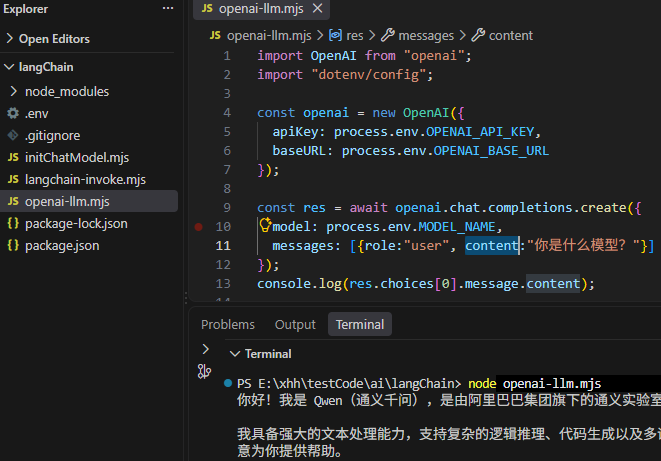
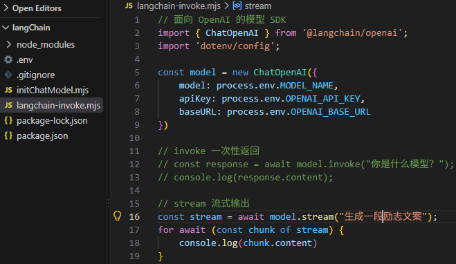
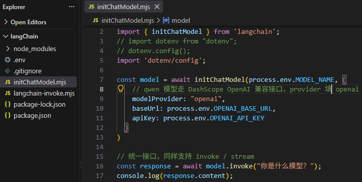

# AI

## Prompt

提示词基础模板

> 通用结构：`角色 + 任务目标 + 技术栈 / 环境 + 业务需求 + 代码规范 & 细节要求 + 输出格式 + 约束限制`

1. **角色**：指定 AI 身份（后端工程师 / 前端开发 / 架构师 / 测试工程师 / 代码审计专家）
2. **任务目标**：核心要做什么（写接口、修复 bug、重构函数、写单元测试、解释代码、设计数据库表）
3. **技术栈 / 运行环境**：语言、框架、版本、包管理器、运行平台（Vue2 + uni-app、Node.js 20、MySQL8、微信小程序原生、ECharts 5）
4. **业务需求**：业务逻辑、入参、出参、边界场景（分页、异常报错、权限校验）
5. **代码规范 & 细节要求**：命名风格、注释、错误处理、性能要求、是否兼容旧版本
6. **输出格式**：代码块、markdown、流程图、SQL、测试用例、注释文档、分步思路
7. **约束限制**：禁止内容（代码简洁、不要引入第三方库、禁止使用废弃 API、不要省略异常捕获）

资源：https://www.prompt123.cn/

## LLM 

大语言模型(Large Language Model)，通过 Prompt 接收指令，生成文本或结构化内容。

LangChain 是面向 LLM 的应用开发框架，统一封装调用各类大模型，同时支持提示词管理、会话记忆、向量检索、工具调用、Agent 编排，用来快速构建复杂 AI 应用。

调用 LLM 的方式一（直接使用 `openai` SDK）：



调用 LLM 的方式二（LangChain `ChatOpenAI`（Model Class））：

调用 LLM 的方式三（LangChain `initChatModel`（统一工厂函数））：

| Model Class | initChatModel |
| ---- | ---- |
|  |  |

---
| 对比 | ChatOpenAI（Model Class） | initChatModel（工厂函数） |
| ---- | ------------------------- | ------------------------- |
| 所属NPM包 | `@langchain/openai` | `langchain`（主包）；根据`modelProvider`自动加载对应适配器包 |
| 导入方式 | 需要手动`import {ChatOpenAI} from "@langchain/openai"` | 仅导入`initChatModel`，无需手动导入各类模型类 |
| 创建方式 | 同步 `new ChatOpenAI()`，**不需要await** | 异步函数，**必须await** |
| 底层实例 | 直接创建 `ChatOpenAI` | 根据`modelProvider`自动实例化对应模型类<br>• `modelProvider:"openai"` → `new ChatOpenAI()`（依赖包`@langchain/openai`，OpenAI兼容协议）<br>• `modelProvider:"alibaba_tongyi"` → `new ChatAlibabaTongyi()`（依赖包`@langchain/community`，DashScope原生协议） |
| 对接协议 | DashScope OpenAI兼容模式：<br>`/compatible-mode/v1/chat/completions` | ✅`openai`：兼容模式<br>✅`alibaba_tongyi`：DashScope原生协议`/api/v1/services/aigc/text-generation/generation` |
| 密钥字段 | `apiKey`，需要配置`baseURL` | `openai`：`apiKey`+`baseUrl`<br>`alibaba_tongyi`：`alibabaApiKey`，**不需要baseUrl** |
| modelProvider 参数| 无这个参数，直接 new 对应类 | 可选；模型 (gpt/claude) 可省略；qwen 等模型必须显式填写，或使用`provider:model`格式|
| 切换模型厂商 | 换厂商需要修改import和new代码，改动量大 | 修改`modelProvider`，上层`.invoke()`/`.stream()`代码不变 |
| 参数能力 | 支持ChatOpenAI适配器全部参数 | 通用参数统一；各适配器独有参数受限制 |


---
https://docs.langchain.com/oss/javascript/langchain/models


## Skills

- https://skills.sh/： Vercel 发布的可视化的 AI Skills 平台

- agent-skills： Agent 技能库（vercel‑labs/agent‑skills，github 仓库，一堆 SKILL.md 技能文件）
```
npx skills add vercel-labs/agent-skills --skill react-best-practices -g

GitHub真实源码页：
https://github.com/vercel-labs/agent-skills/tree/main/skills/react-best-practices

skills.sh预览页：
https://skills.sh/vercel-labs/agent-skills/react-best-practices
```

- 区分2个仓库
```
vercel‑labs/agent‑skills → 前端规范类

vercel‑labs/skills → 底层基础技能 fs/shell/find‑skills等
```

- 终端搜索社区技能
```
npx skills find "关键词"
```

- 安装整套agent‑skills
```
npx skills add vercel‑labs/agent‑skills -g
```
默认目录： `.agents/skills`，Cursor、Windsurf、Cline、OpenAI Codex **原生自动扫描读取**；

claude code 原生不会扫描，如需给 claude code 使用可加 `-a "*"`分发副本： **npx skills add xxx-skill -a claude-code**

- 安装技能两种等价语法
```
npx skills add <owner/repo> --skill <skill> -g
```
```
npx skills add <owner/repo@skill> -g
```

- find-skills 技能发现神器(元技能，AI 对话内自动调用搜索市场)
```
Source: https://github.com/vercel-labs/skills.git

Details: https://skills.sh/vercel-labs/skills
```
```
npx skills add https://github.com/vercel-labs/skills --skill find-skills -g
```
触发场景：当你说 "有没有处理 docx 的技能" 时自动激活，搜索技能市场

- frontend-design 前端界面设计神器
```
Source: https://github.com/anthropics/skills.git

Details: https://skills.sh/anthropics/skills
```
```
npx skills add anthropics/skills --skill frontend-design -g
```
触发场景：当你说 "做一个五一促销活动的HTML页面" 时自动激活该技能（强调视觉风格、排版、色彩和动效）

- 查看已安装的全部技能
```
npx skills list
```
不带 ‑g：列出项目本地 + 全局；
带 -g：仅过滤输出全局已安装技能。

- 检查更新
```
npx skills check 
```

- 更新所有技能
```
npx skills update
```

### 使用 openskills 管理技能

```
openskills install anthropics/skills -g
```
默认目录： `.claude/skills`，Claude Code 原生会**直接扫描此文件夹自动加载技能**。


如果携带 `--universal` 目录则为 `.agent/skills`；
该目录不会被 AI 原生扫描；每次增删技能都必须执行 sync；
扫描本机装好的技能，更新项目根目录的 `AGENTS.md` 文件：
```
openskills sync -y
```

列出已安装的技能：
```
openskills list
```


## MCP

模型上下文协议(Model Context Protocol)

统一接入外部工具

[qoder配置Figma MCP](./qoder.md)

[cursor配置Figma MCP](./cursor.md)

[codex配置Figma MCP](./codex.md)

[copilot配置Figma MCP](./githubcopilot.md)


## AGENTS.md
该文件在项目根目录，为 AI Agent 项目指令，供 Cursor、Qoder、GitHub Copilot 等读取；

优先级：IDE原生rules > AGENTS.md；子目录可就近放置AGENTS.md。
```
# AGENTS.md
- 回答或注释优先使用中文
- 思考过程也用中文

## 项目基础信息
- 技术栈：Vue3 + TypeScript + Vite
- 包管理器：pnpm
- UI 组件库：Vant2
- 样式方案：SCSS
- 别名：`@` -> `src/`

## 目录约定
- src/components：通用组件
- src/pages：页面业务代码
- src/api：接口请求
- src/utils：工具函数
- src/store：状态管理
- dist / node_modules：产物，禁止修改

## 编码规范
1. 优先使用 TS，尽量避免 `any`，优先定义 interface / type
2. 组件命名大驼峰，文件命名小驼峰
3. 接口请求统一放到 src/api，禁止页面内直接写axios请求
4. 样式使用 scoped，尽量复用全局变量，不写硬编码颜色
5. 代码尽量拆分，单个文件不要过长

## 项目命令
- 启动开发：`pnpm dev`
- 构建打包：`pnpm build`
- 代码检查：`pnpm lint`

## NEVER 禁止规则
- 禁止使用内联样式，除非需要动态计算
- 禁止修改 node_modules、dist 目录 和 .lock 文件
- 禁止随意修改 package.json 依赖版本
- 禁止删除已有业务逻辑，如需删除先注释并说明
- 禁止引入未在项目中使用的新依赖，新增依赖必须先询问
- 禁止直接写死接口地址，统一使用环境变量

## 协作约定
- 代码变更尽量小范围提交，一次只解决一个问题
- 修改代码后，简要说明改动点
```

### DESIGN.md
本文件供AI读取，定义项目UI、组件、数据设计规范，配合AGENTS.md使用。
```
# DESIGN.md

## 主题色
- primary: #1677ff
- danger: #f53f3f
- text: #333
- background: #fff

## 间距规范
- base: 8px
- sm: 16px
- md: 24px
- lg: 32px

## 字体
- font-sm：12px 小字
- font-base：14px 正文
- font-lg：16px 标题

## 组件设计原则
1. 组件职责单一，一个组件只做一件事
2. 组件props尽量使用interface定义，避免松散类型
3. 通用组件不要写死业务逻辑，通过props控制业务差异
4. 样式优先使用CSS变量，禁止大量硬编码色值

## 数据接口约定
- 列表返回统一结构：{ code, data: { list: [], total }, msg }
- 时间字段统一使用 timestamp 时间戳
- 枚举统一放在 src/constants/enums.ts
```

备注：两个文件都会加载进上下文消耗token。