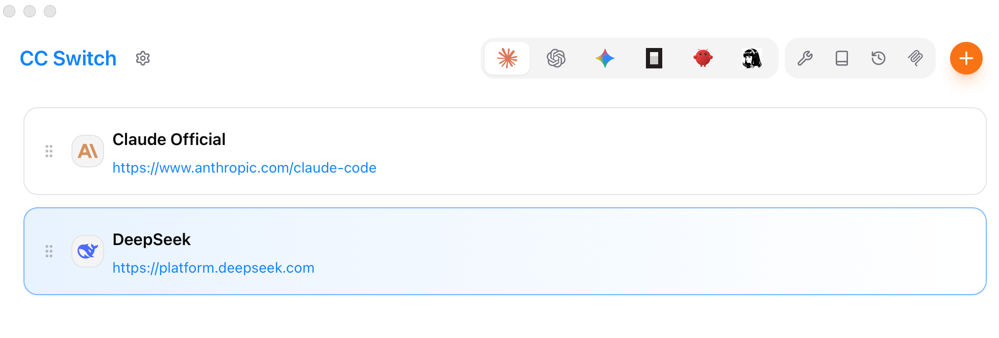
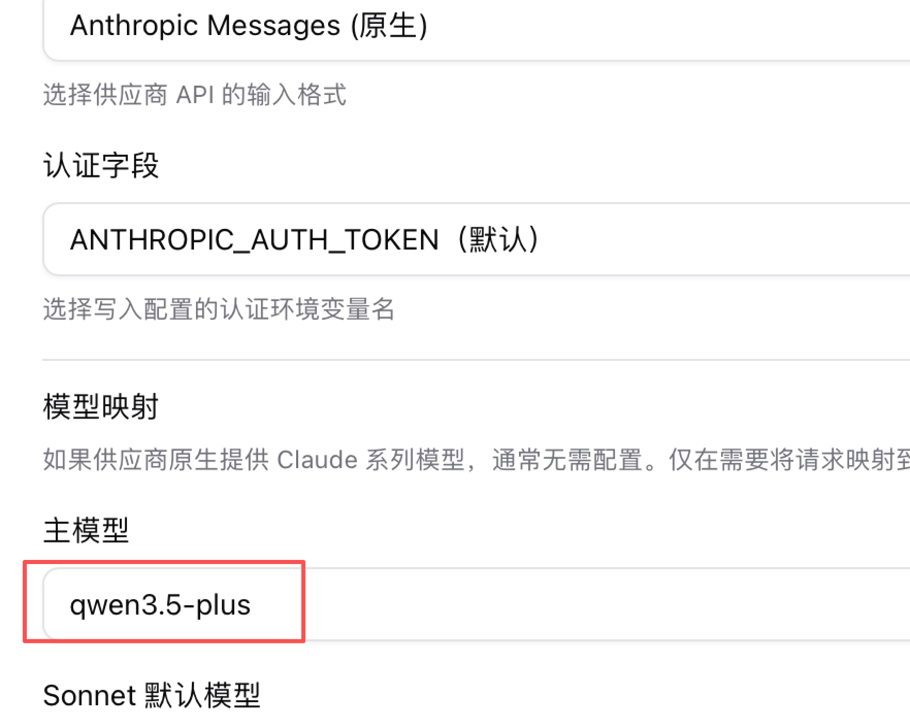
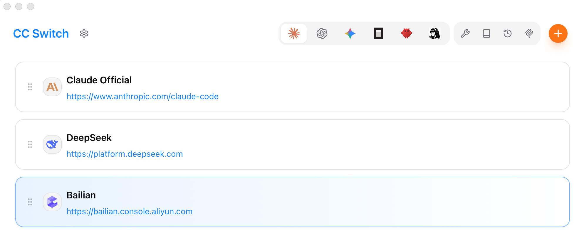
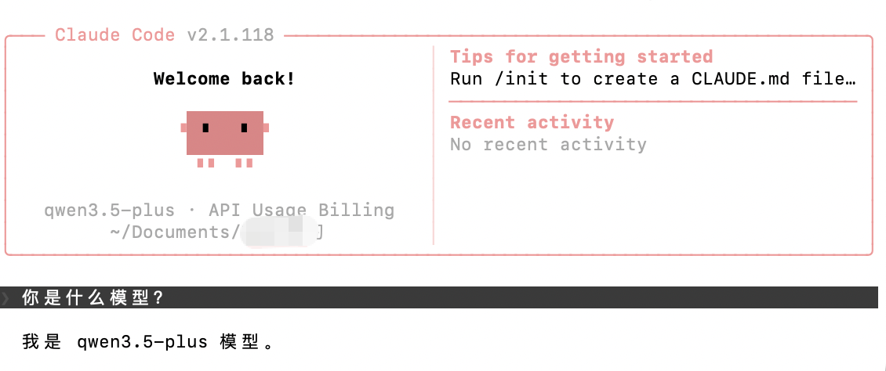
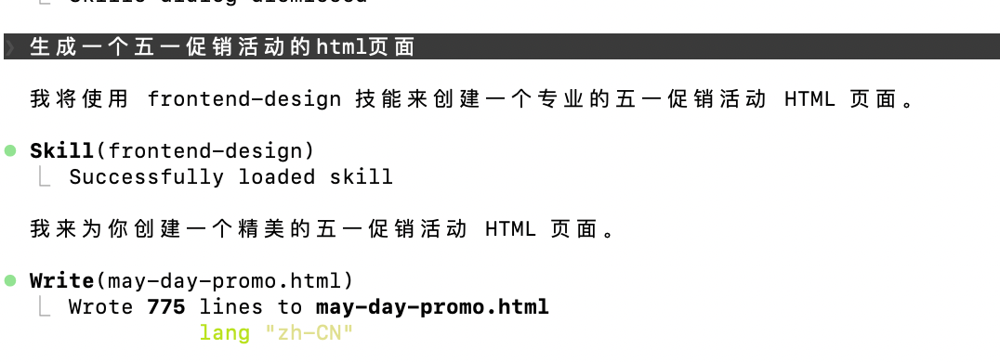
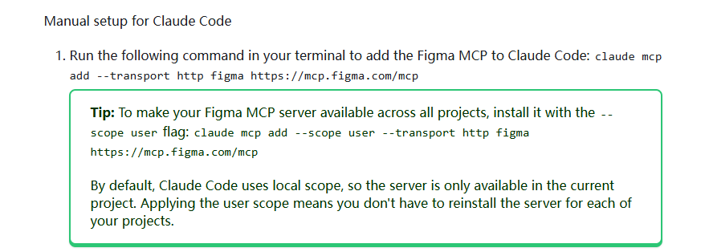

# [Claude Code](https://www.runoob.com/claude-code/claude-code-tutorial.html)

## 安装 claude code

### Mac Homebrew 安装 claude code

在终端输入：
```
brew install --cask claude-code
```

### 查看 claude code 版本
```
claude --version
```

### 安装 CC Switch
CC‑Switch 为社区第三方工具，非 Anthropic 官方，用于切换第三方模型供应商
```
brew tap farion1231/ccswitch

brew install --cask cc-switch
```

## 接入国产大模型

### 接入 DeepSeek 大模型

获取 DeepSeek API key:

https://platform.deepseek.com/api_keys

打开 cc switch，添加新供应商，选择 DeepSeek，输入 API key，点添加即可。



### 接入千问大模型





注意：免费额度用完会自动扣费，先在后台设置用完即停。

## claude code 使用

在终端输入 claude，回车启动；

第一次使用，会有一些初始化设置，比如颜色模式等，选中回车。后续可以输入 /theme 修改。



### 切换模型
```
/model
```
重要区分：原生 `/model` 和 cc-switch `/model`

1.**未安装 cc-switch**：`/model` 是 Claude Code **官方原生内置命令**，仅用于切换 Anthropic 官方 Claude 系列模型（Opus / Sonnet / Haiku）。

2.**安装 cc-switch 之后**：cc-switch 会**劫持覆盖 `/model` 命令**，此时 `/model` 变成 cc-switch 的模型选择器，可以切换 DeepSeek、通义千问等第三方 OpenAI 兼容模型。

> 如果需要原生 `/model` 能力，需要移除 cc-switch。

https://code.claude.com/docs/zh-CN/model-config#setting-your-model

### 退出 claude code
```
/exit
```

### 手动更新 claude-code
```
brew upgrade claude-code
```

### 卸载 claude code
```
brew uninstall --cask claude-code
```

## plugin 和 skills
1.注册插件市场源，把 [github.com/anthropics/skills](https://github.com/anthropics/skills) 仓库添加到插件市场列表：
```
/plugin marketplace add anthropics/skills
```
2.然后安装插件包(example-skills包含12个skill)：

/plugin => Marketplaces => 选中 anthropic-agent-skills => Browse plugins => Discover => example skills

或
```
/plugin install example-skills@anthropic-agent-skills
```

3.查看插件（包括 plugins 包内 skill 和 `~/.claude/skills` 内的 skill）： 

```/skills```

---
Anthropic Skills 文档：https://anthropics-skills.mintlify.app/installation?f_link_type=f_linkinlinenote&flow_extra=eyJpbmxpbmVfZGlzcGxheV9wb3NpdGlvbiI6MCwiZG9jX3Bvc2l0aW9uIjowLCJkb2NfaWQiOiI5NDU1OWJkMDM4Mzc1NGU1LTVhMDEzODdjNzU1NTQwYjAifQ%3D%3D

---

skills 使用示例：


---

| 对比 | Marketplace 插件包 /plugin install | 手动部署 Skill 放入 skills 目录 |
|---|---|---|
| 存储目录 | `~/.claude/plugins/` | `~/.claude/skills/` |
| 最小安装单元 | 整个插件包，一次性安装包内全部技能 | 单个 Skill，按需单独放置 |
| 管理器 | `/plugin` 面板管理 | 无插件管理器，手动管理文件夹 |
| 自动更新 | 支持 marketplace 更新 | ❌ 不支持，手动替换文件 |
| 卸载方式 | `/plugin uninstall` | 直接删除对应文件夹 |
| 刷新技能列表 | `/reload-plugins [--force]` | `/reload-skills` |


## 连接 Figma MCP

打开 Figma 官网文档，先安装 MCP：

https://developers.figma.com/docs/figma-mcp-server/remote-server-installation/#claude-code



在终端输入
```
claude mcp add --scope user --transport http figma https://mcp.figma.com/mcp
```
启动 claude，输入 /mcp，选择 figma，点击 ‌Authenticate，授权访问。

列出所有已配置的服务器
```
claude mcp list
```

<!--
## 安装 claude code、接入 deepseek

### 需要工具：
1. nodejs
2. git
3. CC-Switch 一键轻松切换大模型API
4. VS Code 

### 安装 claudecode
```
npm i -g @anthropic-ai/claude-code
```
```
claude --version
```

### 配置 claudecode
进入用户目录下的 .claude.json 文件，新增：
```
"hasCompletedOnboarding": true
```

### 进入 cluade
```
claude
```
这时提示登录；我们先不登录，准备接入其他的国内大模型。

### 从 github 找到并安装 CC-Switch（windows 3.10.3）
cc-switch 是一个图形化工具‌

### 接入 deepseek 国产大模型
打开 deepseek 官网，API 开放平台，选择 API keys，创建 API key，然后复制该 API key 的密钥；

打开 cc-switch,点击右上角的+号,选择 DeepSeek 模型，填入API key，并保存，这时模型就启用成功了。

### 再次进入 cluade
这时不再提示登录了，输入
```
/model
```
选择 deepseek 模型回车，然后就可以对话了。

### vscode 使用 claudecode
1. 插件模式使用

安装 Claude Code for VS Code插件，右上角就会出来一个 claudecode 图标。

2. 命令行模式使用

打开终端，输入 claude

### cc-switch 接入第三方中转模型
不仅能告别封号风险，还能压缩使用成本。

打开 API 中转平台，创建 API 密钥，在“分组”里选择模型；

打开 cc-switch，添加新供应商（+号），选择自定义配置，粘贴密钥，保存。在模型列表启用当前模型。
-->
