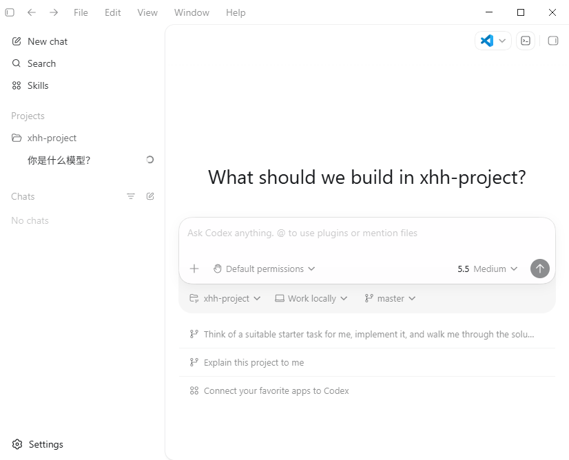
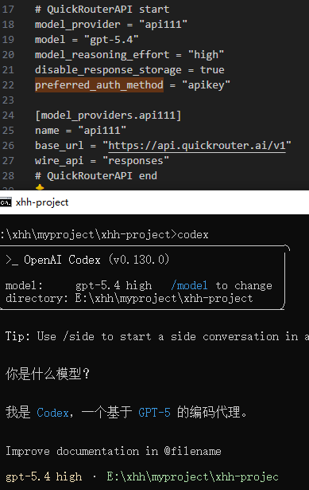
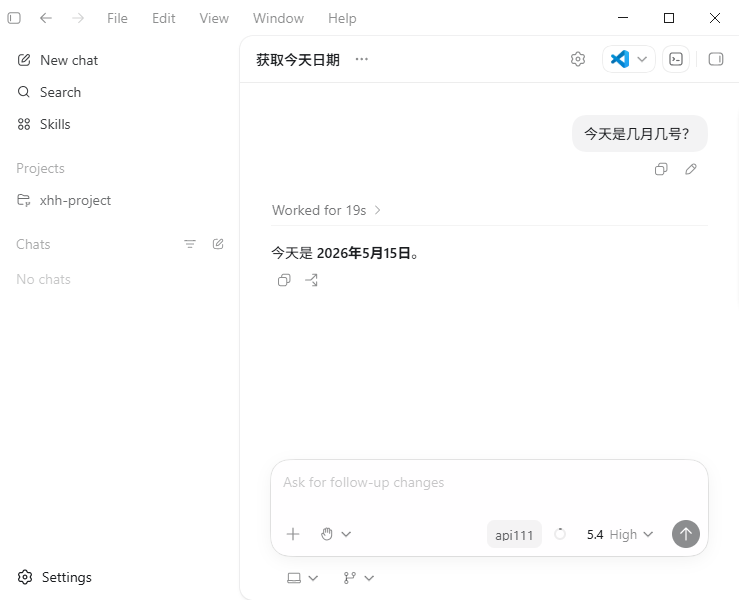
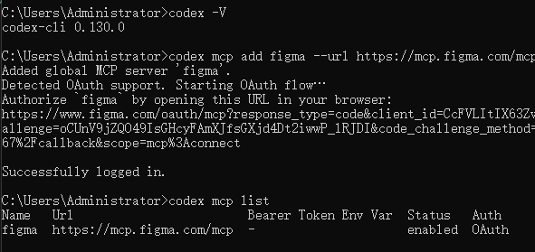
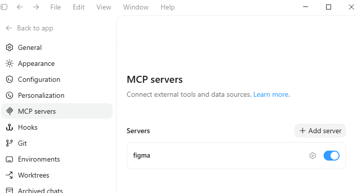
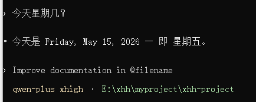
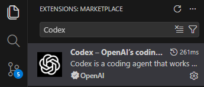

# [codex](https://openai.com/zh-Hans-CN/codex/?utm_source=Ai138.com)

## 安装 codex

cli 工具安装：
```
npm install -g @openai/codex

codex --version
```

> 要求 Node >= 22

或 桌面应用

## 配置文件
```
~/.codex/config.toml
```

配置示例：

config.toml:
```
[model_providers.xxx]
name = "xxx"
base_url = ""
env_key = "XXX_API_KEY"
```
auth.json:
```
{
  "auth_mode": "apikey",
  "XXX_API_KEY": "sk-xxx"
}
```

>备注：优先用`codex login`写入

### codex 使用中转站 api
<!-- 
### API 中转站1

https://jcn08oaqmm57.feishu.cn/docx/ExXAdFe5GonHrJxR49icUDEFnAg



### API 中转站2

https://quickrouter.ai/

-->






## codex 命令

### 系统终端命令（直接在 cmd / bash 执行）
```bash
# 查看全部cli帮助
codex --help

# 交互式登录填写api key
codex login

# 环境诊断，排错首选
codex doctor

# 启动codex交互式对话shell
codex
```

### codex 交互shell内命令
> ⚠️ 必须先输入 `codex` 进入会话

| 交互命令 | 作用 |
| ---- | ---- |
| `/model` | 切换模型 |
| `/new` | 新建对话，清空上下文 |
| `/approvals` | 管理文件读写、shell执行权限 |
| `/init` | 扫描当前目录项目，生成 AGENTS.md |
| `/mcp` | 列出所有MCP服务 |


## 添加 Figma MCP 服务器
```
codex mcp add figma --url https://mcp.figma.com/mcp
```
跳到授权页，同意即可
```
codex mcp list
```

> 备注：如果授权失败，可以执行 `codex mcp remove figma` 删除后重新添加。




## 配置千问模型
https://help.aliyun.com/zh/model-studio/codex?spm=a2c4g.11186623.help-menu-2400256.d_0_4_5.3c386fd113oSgO&scm=20140722.H_3031966._.OR_help-T_cn~zh-V_1#cdx-payg-win-cmd-h

.codex/config.toml文件配置当前模型：
```
# 使用千问模型
model_provider = "Model_Studio"
model = "qwen-plus"
```




<!--
## 上下文记忆
config.toml
```
[features]
memories = true
```
Codex 会把 Memories 存放在 Codex 主目录下，默认 ~/.codex
-->

## VSCode 使用 codex 插件




<!-- 使用 Codex 自带的 apply_patch 工具来修改文件 -->