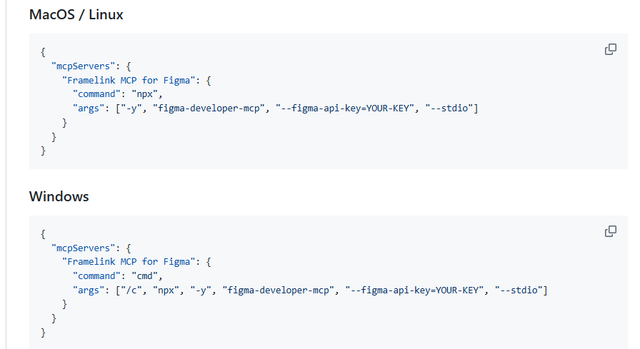
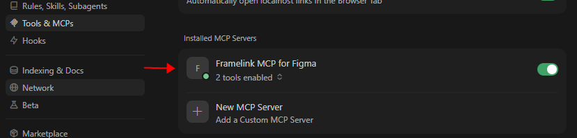
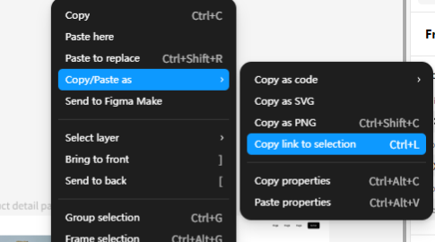
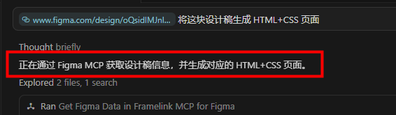
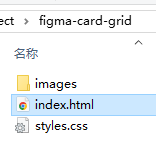

# [Cursor](https://cursor.com/cn/docs/models-and-pricing)

Cursor 是由 Anysphere（现已被 xAI 收购）推出的 AI 优先代码编辑器，基于 VS Code 二次开发，内置 AI 编程智能体。支持全局代码理解、多文件批量编辑、Agent 任务执行，可接入 Claude、Grok 等大模型；支持 rules、skills、MCP 扩展能力，大幅提升开发效率。

## 模型

<!-- https://cursor.com/cn/pricing -->

Cursor 付费套餐分为两套独立月度用量池：

- Cursor 模型池（Grok 4.7/4.6/4.5、Composer 2.5）：套餐自带充足额度。额度耗尽会触发限制，**可以手动开启按需后付费继续调用，默认不会自动扣费**。
- Other Models 第三方模型池（Claude、GPT、Gemini）：Plus(Pro) / 高级版(Pro Plus) / Super(Ultra) 每月自带一定免费额度。额度内调用 Claude 不额外付费；额度耗尽后继续使用，将按 Token 按量后付费。

注意：Auto 自动路由模式，有可能自动选用 Claude 等第三方模型，同样消耗第三方额度，超额会产生额外费用。

## Ctrl + K (Cmd+K)

选中部分代码后按 Ctrl + K，内联 AI 编辑；

## Ctrl + L (Cmd+L)

AI 聊天；

选中代码 => Add to Chat；

## rules

编写规则

- 项目根目录下创建 .cursor/rules 文件夹
- 在rules文件夹新建 .mdc（Markdown with Metadata）后缀文件

最小可用 mdc 模板：
```
---
name: ts‑coding‑style
description: TS/TSX代码规范，何时触发该规则
alwaysApply: true
# globs: ["**/*.ts","**/*.tsx"] # 指定文件匹配时打开
---
## 编码规则
1. xxx
2. xxx
```

## @ 符号

@ 符号增加上下文

## Skills

- 会自动扫描读取：.agents/skills 和 .cursor/skills 和 .claude/skills

- 内置 skill 所在目录： ~/.cursor/skills-cursor/，不要动

- 个人技能：~/.cursor/skills/技能名/SKILL.md

- 项目技能：项目根目录 .cursor/skills/技能名/SKILL.md

- 一键创建：/create-skill, 填写：名称、描述、指令等，自动生成

- 触发：自动激活相关技能；聊天框输入 /, 选择 skill，即可使用该技能


最小可用模板:
```
---
name: your-skill-name
description: Brief description of what this skill does and when to use it.
---

# Your Skill Name

## Instructions
Clear, step-by-step guidance for the agent.
```

## MCP

### 1. 获取 Figma 的 API Key

Figma => Settings => Security => Generate new token，勾选各类读取权限，将生成的 token 复制保存好。

### 2. 建立 Figma 与 Cursor 的 “数据通信桥梁”

打开 Figma GitHub 仓库：

https://github.com/GLips/Figma-Context-MCP

找到仓库中的 MCP 配置代码，根据本机设备系统直接复制全部内容



将刚才生成的 Figma API KEY 替换掉 MCP 配置代码中的 "YOUR-KEY"。

### 3. 在 Cursor 中配置 MCP

Cursor Settings => Tools & MCPs => New MCP Server

将上面 MCP 配置代码复制到 mcp.json 文件中。

然后重启 Cursor



出现绿灯就代表MCP服务进程连通。

> 备注：Figma‑Context‑MCP 服务要求 Node ≥ 22

> 其他配置方法：```https://developers.figma.com/docs/figma-mcp-server/remote-server-installation/#cursor```

### 4. 调用 MCP 生成 html 页面

设计稿，右键选择 Copy as Code 或 Copy as link 


<!-- https://www.figma.com/design/oQsidlMJnlnIlYfMT4lboB/newfile1?node-id=1-1103&t=GUz1bbxKkzBN34J9-4 -->

将链接或代码粘贴到 Cursor 对话框中


生成的 html 页面如下



## .cursorignore

设置不让 AI 访问的文件或目录，和 .gitignore 语法一样。