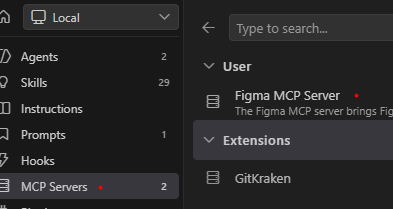
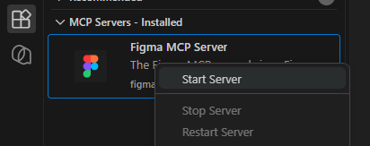

# Github Copilot

## 简介

GitHub Copilot 是 GitHub 与 OpenAI 合作推出的编程辅助工具。它基于大规模语言模型，为你在编辑器中提供自动补全、代码片段建议、整段实现和注释生成等能力，帮助你更快地编写代码、探索实现思路和生成文档示例。

## 安装
以 VS Code 为例

1. 打开 VS Code。
2. 在扩展市场（Extensions）中搜索 “GitHub Copilot”，或直接搜索 `Copilot` 并选择由 GitHub 发布的插件安装。
3. 安装完成后，你需要使用 GitHub 账号登录并完成授权（安装后通常会弹出登录引导窗口，按提示完成）。

## 使用

1.Ctrl+Alt+I‌ (Control+Command+I) 打开聊天界面；

2.选中行 => Add Selection to Chat;

3.在输入代码或注释时，Copilot 会以灰色 "ghost text" 形式给出建议，按 Tab 接受建议，按 ‌Esc‌ 忽略；

## Skills

项目级：
- .github/skills/
- .agents/skills/
- .claude/skills/ 

个人全局skills(所有项目生效)
- ~/.copilot/skills/
- ~/.agents/skills/
- ~/.claude/skills/

## Plugins
| 项目 | Skills | Plugins（Agent Plugin） |
| ---- | ---- | ---- |
| 层级定位 | 最小**能力单元**，是给Agent阅读的任务规则文档 | 打包**分发包/容器**，用于批量分发整套Agent自定义资源 |
| 包含内容 | 仅任务指令 `SKILL.md`（单个子文件夹内） | 可包含 Skills、MCP Servers、Agents、Hooks、Prompts、Commands |
| 加载来源 | 自动扫描固定目录：<br>✅ 项目：`.github/skills` / `.agents/skills` / `.claude/skills`<br>✅ 全局用户目录：`~/.copilot/skills` / `~/.agents/skills` / `~/.claude/skills`<br>✅ 已安装Plugin内部自带技能 | 通过Plugins面板 `Install` 导入（本地路径/远程URL），导入后内部资源自动注册 |
| 面板归类 | 加载后在 `Skills` 面板展示，分 Workspace / User 分组 | 在 `Plugins` 面板管理；打包内的Skills会自动出现在Skills列表 |
| 加载触发 | Agent根据任务上下文，**按需自动加载匹配的skill** | 插件一旦安装，包内所有资源一次性注册就绪，Agent可直接调用 |
| 主要用途 | 项目本地编写、维护独立小能力，跟随代码仓库提交共享 | 团队/社区打包一整套Agent方案分发 |
| 鉴权相关 | Skill本身不携带凭证 | Plugin仅定义MCP服务配置，**不会携带个人账号token**，首次调用MCP仍需手动授权 |
| 生效前提 | 仅Agent模式(Copilot/Local载体)生效，普通聊天/代码补全无效 | 安装完成后，内部所有资源同样仅Agent模式可用 |


## MCP
连接 Figma MCP

### 第一种：项目工作区配置
项目根目录 .vscode 文件夹下 新建 mcp.json:
```
{
  "inputs": [],
  "servers": {
    "figma": {
      "type": "http",
      "url": "https://mcp.figma.com/mcp"
    }
  }
}
```
保存后，在 mcp.json 文件中点击 figma 上方的 Start，连接 Figma MCP

### 第二种：Copilot 设置里配置
Copilot 设置里找到 MCP Servers，安装 Figma MCP Server


启动服务



同意授权即可。

<!-- 此方式对免费账号有调用次数限制（如每月仅 6 次）-->

### 第三种：用户全局配置（本机所有项目生效）

1.打开命令面板，执行 `MCP: Add Server`

2.选择`http`类型，填入 Figma MCP 地址 `https://mcp.figma.com/mcp`

3.选择保存为**User 设置（全局）**，启动并完成授权。


## 参考文档

https://docs.github.com/zh/copilot

