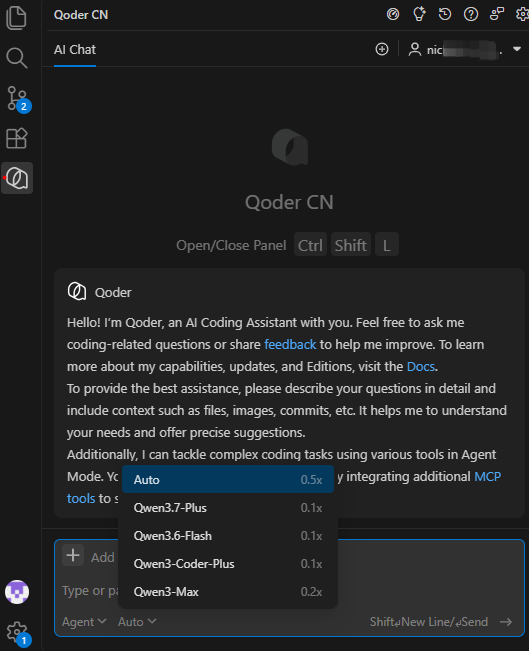

# [Qoder](https://qoder.com.cn/)

Qoder CN（原通义灵码）是阿里云 IDE AI 编程助手，原生适配 VSCode。支持仓库级代码理解、Agent 自动多文件修改、行间代码补全、代码审查，内置通义 Qwen 系列模型。



## Skills

1.桌面客户端-扩展-配置skills

2.目录
```
全局 ~/.qoder-cn/skills/

项目/.qoder/skills/
```

3.Qoder 聊天框输入 `/`，下拉列表会列出**已经加载成功的 skills**，直接点选就能启用这个技能执行任务。

4.新增/修改SKILL.md后，聊天框执行：`/skills reload`

5.查看已加载技能：`/skills`

## MCP

第一种：桌面客户端-扩展-连接器-Figma-登录授权

第二种：Figma 桌面本地 MCP

打开 Figma 桌面，打开目标设计稿，快捷键`Shift+D`切换到 Dev Mode；

右侧检查面板，开启 **Desktop MCP Server**，拿到本地地址：`http://127.0.0.1:3845/mcp`；

Qoder MCP 面板 → 我的服务 → + 添加 → 粘贴 JSON：
```json
{
  "mcpServers": {
    "figma-local": {
      "type": "http",
      "url": "http://127.0.0.1:3845/mcp"
    }
  }
}
```
保存，Qoder 聊天框执行 `/mcp reload` 重载 MCP，`/mcp` 查看已加载 MCP 工具列表。

第三种：无 MCP 方案（不需要配置 MCP 连接器，临时快速使用）

直接在 Qoder 聊天开启 Agent，发送提示词 + Figma 链接，调用 Figma 公开 REST API 解析设计稿
示例提示词：

> 
> 使用 Figma 公开 API 读取这个 Figma 链接，提取图层、色值、字体、尺寸、组件结构，输出 React TSX 代码。
> 优点：不用配置 MCP；缺点：没有 MCP 完整工具能力，适合临时快速转稿