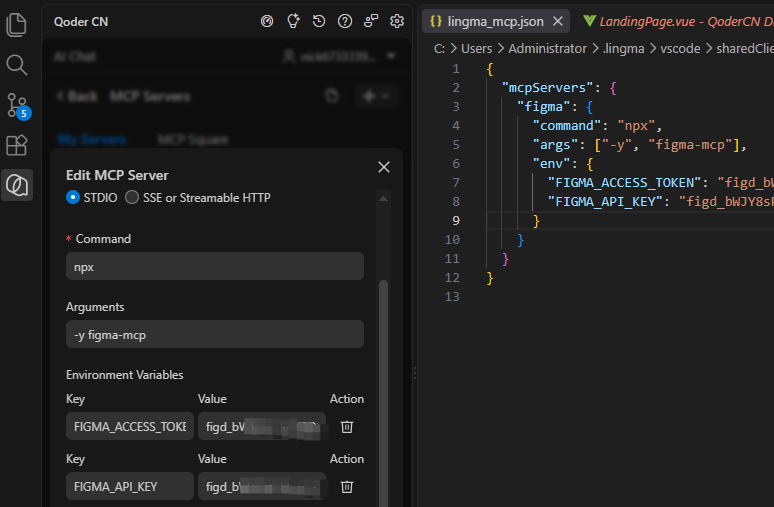
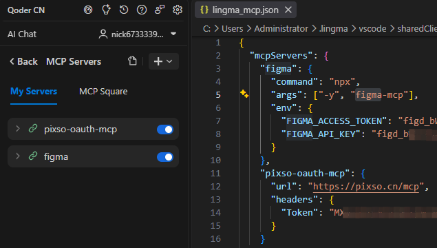
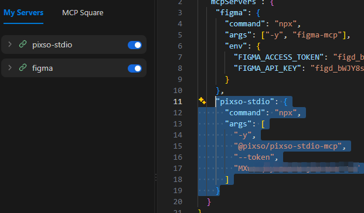
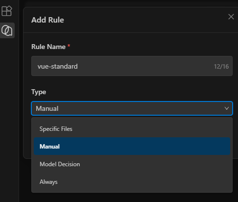
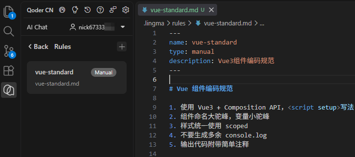

# [Qoder](https://qoder.com.cn/)

Qoder CN（原通义灵码）是阿里云 IDE AI 编程助手，原生适配 VSCode。支持仓库级代码理解、Agent 自动多文件修改、行间代码补全、代码审查，内置通义 Qwen 系列模型。

VSCode Qoder CN 插件：


## Skills
|类型	|路径	|作用域|
| ---- | ---- | ---- |
|项目级 Skills|	项目根目录/.lingma/skills|	仅对当前项目生效|
|全局 Skills|	用户主目录/.lingma/skills|	对所有项目生效|

输入 `/技能名称` 调用

## MCP

### [Figma MCP](https://www.figma.com/files/team/1634847543948087953/recents-and-sharing/recently-viewed?fuid=1634847540959498009)

Qoder CN 聊天面板 => 右上角用户 => Settings => MCP Servers => Add by JSON:



这里使用的是 MCP 协议的通用 STDIO 配置。

| 对比 | stdio | SSE/HTTP |
| ---- | ---- | ---- |
| 通信含义 | 本地进程管道通信，Qoder 拉起 Node 子进程，通过控制台输入输出传递MCP消息 | HTTP SSE长流网络通信，先GET建立长连接，后续指令POST交互 |
| Figma官方支持 | ❌ 官方无stdio版本，可使用第三方社区包`figma-mcp`、 [figma-developer-mcp](https://github.com/GLips/Figma-Context-MCP) | ✅ Figma官方MCP原生基于SSE |
| 配置写法 | `command` + `args` + `env` | `type:http` + `url` 授权登录 |


### [Pixso MCP](https://pixso.cn/)

远程 MCP(Streamable HTTP) 方式：



STDIO 模式：




<!-- 未求证，先注释
第一种：桌面客户端-【MCP 管理面板】-Figma-登录授权

第二种：Figma 桌面本地 MCP

打开 Figma 桌面，打开目标设计稿，快捷键`Shift+D`切换到 Dev Mode；

右侧检查面板，开启 **Desktop MCP Server**，拿到本地地址：`http://127.0.0.1:3845/mcp`；

Qoder MCP 面板 → 我的服务 → + 添加 → 粘贴 JSON：
```json
{
  "mcpServers": {
    "figma-local": {
      "type": "http",
      "url": "http://127.0.0.1:3845/mcp"
    }
  }
}
```
保存，Qoder 聊天框执行 `/mcp reload` 重载 MCP，`/mcp` 查看已加载 MCP 工具列表。

第三种：无 MCP 方案（不需要配置 MCP 连接器，临时快速使用）

直接在 Qoder 聊天开启 Agent，发送提示词 + Figma 链接，调用 Figma 公开 REST API 解析设计稿
示例提示词：


> 使用 Figma 公开 API 读取这个 Figma 链接，提取图层、色值、字体、尺寸、组件结构，输出 React TSX 代码。
> 优点：不用配置 MCP；缺点：没有 MCP 完整工具能力，适合临时快速转稿
-->

## Rules

方案1：界面创建


 
- 规则类型（3 种）
  - Manual（手动引入）：聊天框输入 `@vue-standard` 才启用
  - Model Decision：AI 自动判断场景触发（比如写代码时自动生效）
  - Specific Files：指定文件后缀自动生效，例如`*.vue,*.js`
  - Always：**当前项目下，所有对话/提问，强制永久加载这条规则**，无需手动 @，慎用



方案2：手动新建文件

项目根目录新建文件夹 .lingma/rules/，在 rules 文件夹新建 `vue-standard.md` 文件