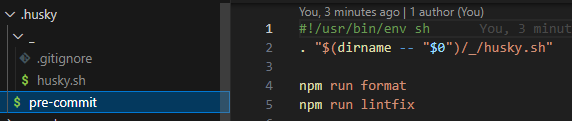

# precommit 代码提交检查

### 老 husky v1 方案

1.安装模块(--save-dev)
```
"husky": "^1.3.1"
"lint-staged": "^12.3.4"
```


2.package.json 配置
```
"husky": {
  "hooks": {
     "pre-commit": "lint-staged"
   }
 },
 "lint-staged": {
    "src/**/*.{js,vue}": [
      "prettier --write",
      "eslint --fix"
    ]
 }
 ```


3.添加要提交的代码进暂存区，进行git commit操作，会依次执行 prettier --write和eslint --fix，代码格式如果有问题无法提交成功

如果想要越过检查，添加 --no-verify

备注：如果项目根目录自动生成.eslintcache缓存文件，想要去掉的话，查看是否有 "eslint --cache --fix" 配置，去掉--cache即可


### husky v8/v9 + lint-staged 主流
[husky](https://typicode.github.io/husky/)

1. 安装

```
npm i -D husky lint-staged prettier eslint
```

2. package.json

```
{
  "scripts": {
    "prepare": "husky install"
  },
  "lint-staged": {
    "src/**/*.{js,vue}": [
      "prettier --write",
      "eslint --fix"
    ]
  }
}
```
- 执行顺序：先 prettier 格式化，再 eslint 自动修复
- lint-staged 只会处理**本次 git 暂存区的文件**，不会全量扫描整个项目，速度更快
- lint-staged 修复完成后，会自动把修改后的文件重新 add 进暂存区

3. 初始化 + 添加钩子

```
# 执行 prepare 脚本，初始化 husky，生成 .husky 目录
npm run prepare

# 添加 pre-commit 钩子，提交时执行 lint-staged
npx husky add .husky/pre-commit "npx lint-staged"
```

<!--  -->

