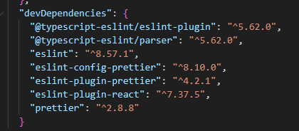

# 代码规范与格式化

## Prettier（格式化工具）

1. vscode 安装 Prettier 插件(配置 `.prettierrc.js` + `.vscode/settings.json`)
2. 项目安装 prettier 包(命令行脚本 `prettier --write`)
3. 项目根目录新建 .prettierrc.js
```
module.exports = {
    endOfLine: "lf", // 行结束符使用 Unix 格式
    semi: false,
    singleQuote: true,
    tabWidth: 2,
    useTabs: false,
    trailingComma: "none"
}
```
4. package.json 添加 script:
```
"format": "prettier --write \"src/**/*.+(js|jsx|ts|tsx|vue)\""
```
执行命令 npm run format 自动修复代码格式

5. 根目录.vscode/settings.json:
```
// 全局默认格式化器
"editor.defaultFormatter": "esbenp.prettier-vscode",
// 格式化交给 prettier
"editor.formatOnSave": true,
// 优先使用项目内的 prettier 包版本，保证编辑器和命令行格式化结果一致
"prettier.useLocalVersion": true
```

## ESLint（Lint 校验工具）

1. vscode 安装 ESLint 插件
2. 项目安装 eslint 模块

- `plugin:react/recommended` → `eslint-plugin-react`
- `plugin:@typescript-eslint/recommended` → `@typescript-eslint/parser`、`@typescript-eslint/eslint-plugin`
- `plugin:prettier/recommended` → `eslint-plugin-prettier`、`eslint-config-prettier`
- `react-refresh/only-export-components` → `eslint-plugin-react-refresh`

<!-- ### 安装模块
 -->

3. 项目根目录新建 .eslintrc.js
```
module.exports = {
  env: {
    browser: true,
    es2021: true
  },
  extends: [
    'eslint:recommended',
    'plugin:react/recommended',
    'plugin:@typescript-eslint/recommended',
    'plugin:prettier/recommended'
  ],
  parser: '@typescript-eslint/parser',
  parserOptions: {
    ecmaVersion: 'latest',
    sourceType: 'module'
  },
  plugins: ['react', '@typescript-eslint'],
  rules: {
    // 只保留【代码质量、逻辑类规则】，格式化规则用 .prettierrc.js
    'prefer-const': 0, // 0 代表 off（关闭）、1 代表 warn（警告）
    'no-var': 2, // 2 代表 error（报错）
    '@typescript-eslint/no-unused-expressions': 'off',
    '@typescript-eslint/no-explicit-any': 'off',
    'react-refresh/only-export-components': 'off',
    '@typescript-eslint/no-this-alias': 'off',
    'react-hooks/exhaustive-deps': 'off'
  }
}
```
4. package.json 添加 script:
```
"lint": "eslint --fix \"src/**/*.+(js|jsx|ts|tsx)\""
```
执行 `npm run lint`：自动修复可修复的 eslint 代码问题；无法修复的错误直接抛出。

5. 根目录.vscode/settings:
```
{
  "editor.codeActionsOnSave": {
    "source.fixAll.eslint": "explicit"
  }
}
```
eslint.format.enable：让 eslint 插件**提供格式化能力**；（这里不要开启，格式化由 prettier 处理）

editor.codeActionsOnSave：保存时执行eslint自动修复代码质量问题

### 如果项目是Vue项目，额外要改
1. 安装：`npm i -D eslint-plugin-vue`
2. extends增加：`plugin:vue/vue3-recommended`（vue3）
3. parser 改成 `vue-eslint-parser`
4. lint脚本后缀加上 `vue`
5. plugins增加 `vue`

## ESLint 和 Prettier 冲突处理
1. 使用第三方包处理（推荐）
```
eslint-config-prettier
eslint-plugin-prettier
prettier
```

> `plugin:prettier/recommended`（放在 extends 数组最后）：格式化交给 prettier，eslint只做代码质量校验，等价于：
> 1. 开启 `eslint-config-prettier`：关闭 ESLint 里面和 Prettier 冲突的格式化规则
> 2. 开启 `eslint-plugin-prettier`：把 Prettier 的格式化结果当成 ESLint 的一条 rule（prettier 规则），校验不通过就报 eslint 错误，并且可以被 `--fix` 修复

> 编辑器这边：配置 `"editor.defaultFormatter": "esbenp.prettier-vscode"`，开启 `editor.formatOnSave`，指定默认格式化器为 Prettier；也可以单独给 js/ts/vue 等文件类型单独指定 formatter，优先级更高。

eslint配置文件：
```
{
  extends: ['eslint:recommended', 'plugin:prettier/recommended']
}
```


2. eslint 作为格式化器

.vscode/settings.json:
```
{
  // 格式化器能力（右键【格式化文档】）
  "eslint.format.enable": true,
  // 全局默认格式化器改成 eslint
  "editor.defaultFormatter": "dbaeumer.vscode-eslint",
  "editor.formatOnSave": true,

  // 单独给js/ts/jsx指定，防止其他插件抢占
  "[javascript]": {
    "editor.defaultFormatter": "dbaeumer.vscode-eslint"
  },
  "[javascriptreact]": {
    "editor.defaultFormatter": "dbaeumer.vscode-eslint"
  },
  "[typescript]": {
    "editor.defaultFormatter": "dbaeumer.vscode-eslint"
  },
  "[typescriptreact]": {
    "editor.defaultFormatter": "dbaeumer.vscode-eslint"
  },

  // lint修复
  "editor.codeActionsOnSave": {
    "source.fixAll.eslint": "explicit"
  }
}
```
而且 .eslintrc 里**不能有 `plugin:prettier/recommended`**，要自己维护所有格式化 rules（就是 semi、quotes、indent 这些）。


--- 
参考文档：

https://www.tkcnn.com/eslint/rules.html

https://prettier.io/docs/options
