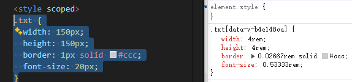

# rem / vw 插件配置说明

## px 转 rem
`postcss-pxtorem`

在构建阶段把 CSS 里的 px 值按指定基准 (rootValue) 自动转换成 rem。

### 设置移动端 viewport
```
<meta name="viewport" content="width=device-width, initial-scale=1.0" />
```

### 安装模块
```
npm install -D postcss@8 postcss-pxtorem@6
```

### 配置 postcss.config.cjs
```js
module.exports = {
  plugins: {
    "postcss-pxtorem": {
      rootValue: 37.5,
      // 哪些CSS属性允许px转rem; ['*']=全部属性都转
      propList: ['*'], // 例 ['*', '!font-size'] 所有属性转，唯独 font-size 不转
      mediaQuery: false, // 保留媒体查询条件中的 px
      exclude: /node_modules/i, // 不进行px转rem（文件路径过滤）
      selectorBlackList: ['.norem'], // 选择器黑名单，含有norem类的元素不转 rem
      minPixelValue: 1 // 小于 1px 的不会转 rem
    }
  }
}
```

### 设置根字号
```js
/**
 * 动态设置 html 根字号，适配 rem
 * 设计稿宽度：375px，划分 10 份，基准 rootValue = 37.5
 */
let rafId = null
function updateRem() {
  // 取消上一次未执行的动画帧，防抖
  if (rafId) cancelAnimationFrame(rafId)

  rafId = requestAnimationFrame(() => {
    const docEl = document.documentElement
    // 限制最小、最大宽度，防止屏幕太宽/太窄布局崩坏
    const clientWidth = Math.min(Math.max(docEl.clientWidth, 320), 750)
    docEl.style.fontSize = `${clientWidth / 10}px`
  })
}

// 首次执行
updateRem()

// 窗口大小变化
window.addEventListener('resize', updateRem)

window.addEventListener('pageshow', (e) => {
  // 从bfcache返回时，重新设置根字号
  if (e.persisted) {
    updateRem()
  }
})

// 页面卸载时清理监听（vue单页应用建议加上）
window.addEventListener('pagehide', () => {
  if (rafId) {
    cancelAnimationFrame(rafId)
    rafId = null
  }
})
```
或者使用 `amfe-flexible` 设置根字号，`import "amfe-flexible"` 即可

### 效果


width: 150px 直接取设计稿上元素宽度；

rem值(4rem) = 写的px(150px) / rootValue(37.5);

## px 转 vw
`postcss-px-to-viewport-8-plugin`

纯 CSS 视口单位，不需要 JS 动态设置 html 根字号。

### 设置 viewport


### 安装模块
```
npm install -D postcss-px-to-viewport-8-plugin
```

### 配置 postcss.config.cjs
```js
module.exports = {
  plugins: {
    'postcss-px-to-viewport-8-plugin': {
      unitToConvert: 'px',
      viewportWidth: 375, // 设计稿宽度，750稿就改成750
      unitPrecision: 5, // 小数保留位数
      propList: ['*'],
      viewportUnit: 'vw', // 转换成vw，可选值：`vw` / `vh` / `vmin` / `vmax`
      fontViewportUnit: 'vw', // 专门给字体（font-size）转换用的单位
      selectorBlackList: ['.norem'], // 包含 .norem 的类不转vw，保留px
      minPixelValue: 1,
      mediaQuery: false, // 媒体查询里px不转vw
      replace: true, // 直接替换原来的 px 属性为 vw
      exclude: /node_modules/, // 忽略node_modules里的样式
      landscape: false // 不需要横屏适配，关掉
    }
  }
}
```
> 备注：两个方案都只处理 css/scss/less，模板 `:style` 内联 px 不会转换；大写 `Px` 跳过单行转换比如 `border: 1Px solid #ccc;`